# Wilderstep: Infinite Abyss — Player's Manual

  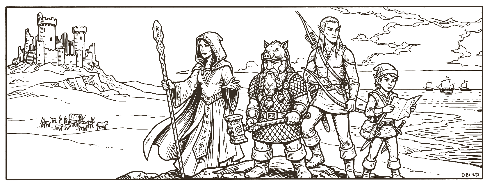

Wilderstep: Infinite Abyss is a turn-based RPG. You assemble a party of adventurers, explore an open world one tile at a time, talk to its people, take on quests, and descend into dungeons full of danger and treasure. This player's manual covers the basic mechanics of the game: races, classes, spells, items, and monsters. The manual is not meant to be comprehensive; Wilderstep is an evolving RPG platform, and if you'd like to build adventures of your own, the companion [Dungeon Master's Manual](dm_manual.pdf) shows you how.

---

**Contents**

- [Getting Started](#getting-started)
  - [Choosing Your Party](#choosing-your-party)
  - [Navigating the Map](#navigating-the-map)
  - [Turn-Based Combat](#turn-based-combat)
  - [Darkness in Combat](#darkness-in-combat)
  - [The Party and Character Sheets](#the-party-and-character-sheets)
  - [Completing Quests](#completing-quests)
  - [Exploring Dungeons](#exploring-dungeons)
  - [What Should You Do First?](#what-should-you-do-first)
  - [Game Saves](#game-saves)
- [Races](#races)
- [Character Classes](#character-classes)
- [Abilities](#abilities)
- [Spells](#spells)
- [Items](#items)
- [Monsters](#monsters)
- [Frequently Asked Questions](#frequently-asked-questions)

---

## Getting Started

Wilderstep has three main components: party creation, world exploration, and turn-based combat. 

### Choosing Your Party

A new game opens on the party formation screen, where you build the group you'll lead into the world.

The module provides a starting roster of ready-made characters, and you can also **create your own** from the button at the top of the screen. A custom character is built by picking a race and a class — your race grants innate abilities and adjusts your starting stats, while your class sets your combat role, how far you can move each turn, what weapons and armor you can equip, and which spells (if any) you can learn. The [Races](#races) and [Character Classes](#character-classes) tables lay out every option so you can plan a balanced group.

Characters waiting on the sidelines sit in an **Available** pool; add any of them to fill your ranks, or remove a member to send them back. You can **reorder** the party by dragging members up and down, and order matters: the member in the first slot is your **lead** — the figure shown walking the world map, and the one who acts first in battle. A common setup puts a sturdy front-liner in the lead and keeps fragile spellcasters further back.

When every slot in your party is filled, choose **Begin** to enter the world (hover over the button to see how many characters you still need). The whole screen also works from the keyboard: `↑` `↓` (or `W` `S`) move the highlight, `Enter` adds the highlighted character to the party or removes them from it, and `Shift` + `↑` `↓` changes a member's place in the marching order. A good first party mixes durability, damage, and a little magic — a Fighter or Paladin to absorb hits, a Cleric or Wizard for spells, and a Thief to handle locks and traps (a Ranger can spot traps too).

### Navigating the Map

Once you begin the game, you will see an icon appear that represents your adventuring party. This icon will be placed on a map that looks something like this:

  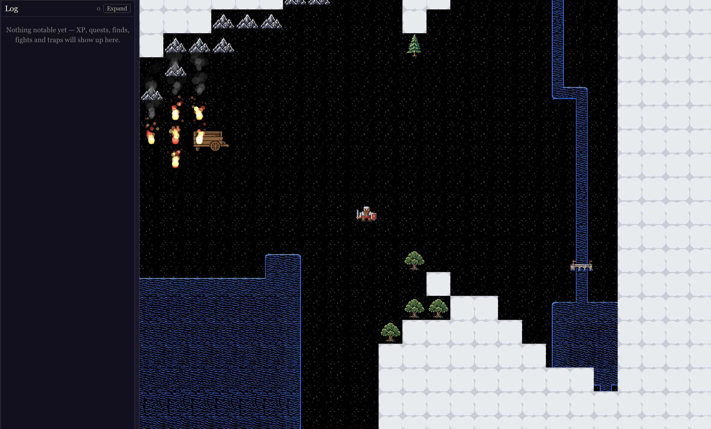

You will see trees, mountains and points of interest like towns depicted on the map. The white "cloud cover" hides areas of the map that you have not explored. Some maps shroud unexplored ground in darkness instead — often only at night, so the same map may be clouded by day and dark after sunset. At the bottom of the screen you will see a readout that displays the day and time and the moon phase. The map will get dark at night.

You explore the world on a grid, moving **one tile per step** using the controls below.

| Key | Action |
|---|---|
| `↑ ↓ ← →` or `W A S D` | Move the party one tile |
| `Space` | Wait a turn in place (the world still moves around you) |
| `P` | Party screen — roster, gold, shared stash, active effects |
| `Q` | Quest log — active and completed quests |
| `L` | Adventure log — the full back-buffer of in-world messages |
| `J` | Journal — the lore you have discovered |
| `H` | Help & tips (and the soundtrack mute / volume controls) |
| `Z` | Zoom the view: 100% / 50% / 25% (map and combat) |
| `F` | Toggle fullscreen |
| `⌘S` / `Ctrl-S` | Save menu — three save slots plus export to a file |

Menus and dialogs — the Party screen, the Quest Log, a quest giver's offer, a treasure chest, a spell's target picker — all work from the keyboard too: the arrow keys move the highlight, `Enter` chooses, and `Esc` backs out.

Almost everything in the world is reached by **walking into it**. Step into a townsperson to talk, into a shop counter to browse its wares, into a locked door to try the lock, and into a quest giver to hear what they need. The same step-to-interact rule covers it all.

Light matters once you leave open daylight. The party carries a light radius that brightens nearby tiles; a lit **Torch** or the **Light** spell extends it, and a Dwarf's Infravision lets that character see in pure darkness without one but only in shades of red. Effects that last for a number of steps — light included — tick down as you move, so keep an eye on the Effects panel of the Party screen (`P`). If a party member can **Detect Traps** (any Thief, or a Ranger from level 3), hidden traps within your light radius show up as red marks before you blunder onto them.

A few other things you'll find out in the world: step onto a boat to sail across water, and onto land to disembark — and unattended shop counters and temples let you trade or buy healing without an NPC to broker it. Shops remember their stock: what you buy is gone until someone sells it back, and anything you sell stays on that counter for you to buy again later. Worn gear sells for less (see [Turn-Based Combat](#turn-based-combat)).

When you step onto a road out of the current map or a dungeon entrance, a **placard** tells you where it leads before you commit. It shows the place's name and description, whether your party has been there (**Explored** / **Unexplored**), a gold **⚜ Quest** tag and the objective when one of your active quests needs something there, and a green **✓ Cleared** tag on a dungeon you've already emptied of foes. Press `Enter` to travel (or descend), or `Esc` to stay where you are.

### Turn-Based Combat

When the party meets hostile creatures — a roaming band catches up with you, an ambush springs, or you approach a monster lair — an **encounter screen** comes up first. It shows who you're facing, with a portrait and description of each foe, and asks how you want to handle it:

| Choice | What happens |
|---|---|
| **Fight** | Straight into battle. |
| **Run** | The party attempts a group Dexterity saving throw to slip away. Backing away from a lair you've approached needs no roll. |
| **Talk** | Only against humanoids — a small chance to talk your way out of the fight. |

A failed Run or Talk shows the dice and then drops you into battle anyway. You must choose; `Esc` won't dismiss the screen. Press `F`, `R`, or `T`, or use the arrow keys and `Enter`.

If you fight, the game switches to a dedicated **battle screen**: a turn-based arena where your party lines up on one side and the enemies on the other. Turns proceed in order, and your party acts in the order you arranged on the formation screen.

  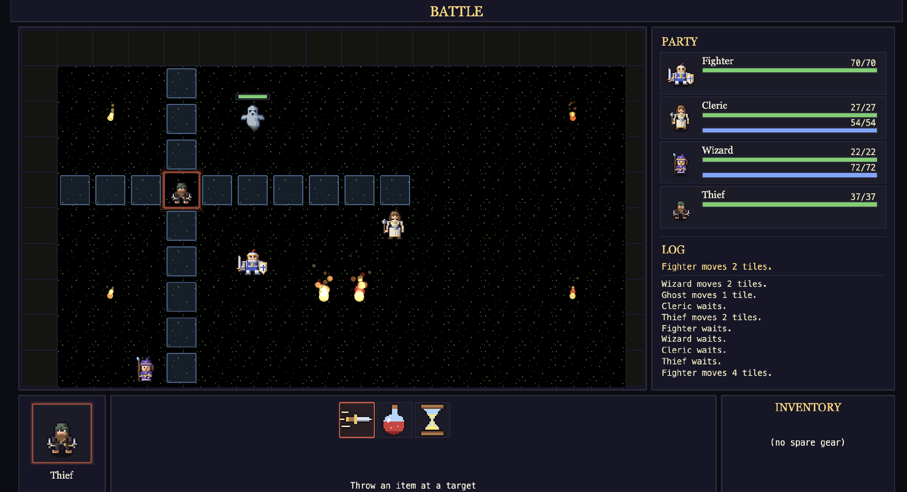

In the battle arena depicted above, you can see the party facing off a goblin. It is the ranger's turn and you can see how many moves he has left. The party status is shown on the right and the current character's options are display below that. The ranger can cast spells, use a ranged weapon, throw a torch, and do a few other things.

On a character's turn you can move up to that class's movement budget (the `Range` value in the [Character Classes](#character-classes) table — a nimble Thief covers far more ground than a Wizard) and then take one action:

| Action | What it does |
|---|---|
| **Attack** | Strike an adjacent enemy with your equipped weapon |
| **Range** | Fire a bow, crossbow, or sling at a distant foe (consumes ammo) |
| **Throw** | Hurl a throwable item — a rock, a flask, a lit torch |
| **Cast** | Spend MP to cast a spell from your catalog |
| **Abilities** | Use a combat ability such as a Cleric's Turn Undead |
| **Use Item** | Drink a potion, apply an antidote, or use another combat consumable |
| **Equip Item** | Swap the weapon or armor you're holding (uses your turn) |
| **End Turn** | Pass to the next combatant |

Controls in the arena:

| Key | Action |
|---|---|
| `↑ ↓ ← →` | Move the cursor, or step the active combatant |
| `Enter` | Activate the highlighted action / confirm a target |
| `1`–`9` | Pick an option from a list (target, spell, item) |
| `Space` | End your turn |
| `Esc` | Cancel the current sub-mode (e.g. back out of the target picker) |

### Darkness in Combat

Your character can only target monsters that he can see, so when fighting in the dark it helps to throw a torch or to cast a light spell.

  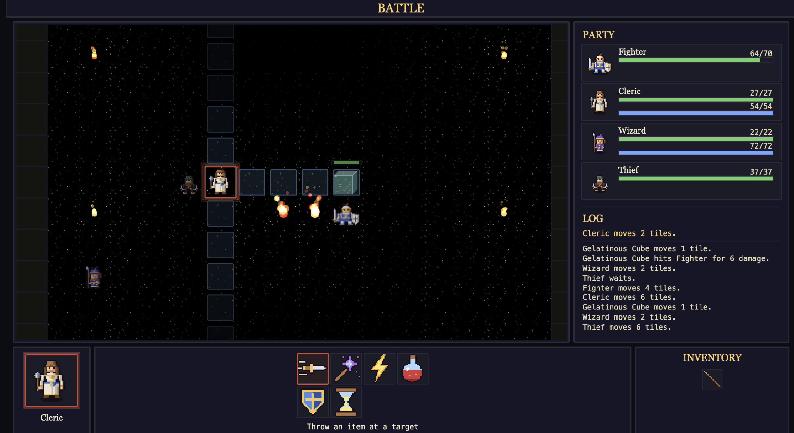

A battle that takes place in darkness is harder because you can't see your enemies at first. Here you can only see one of the orcs that happens to be standing near a torch. The party has already thrown a torch to try and reveal the other orcs. A light spell would work great here.

Once battle is joined there is no fleeing — the time to run is on the encounter screen. The fight ends when one side is wiped out; win, and you return to the map with any spoils. If your whole party falls, the adventure ends on a somber screen that offers to **continue from your last save** or start a new game.

Gear wears out with use. A weapon loses a little durability each time it lands a blow, and body armor each time its wearer is hit; the Party screen and character sheets show each piece's condition. Worn gear works just as well, but it sells for less (a shop pays in proportion to how much durability is left), and when a piece's durability runs out it **breaks** and is lost. Keep a spare weapon in the stash for long dungeon crawls.

### The Party and Character Sheets

You can view your party and get access to party effects like Detect Traps, Infravision, and more by pressing "P" to get to your party screen. This is where you manage your inventory as well.

  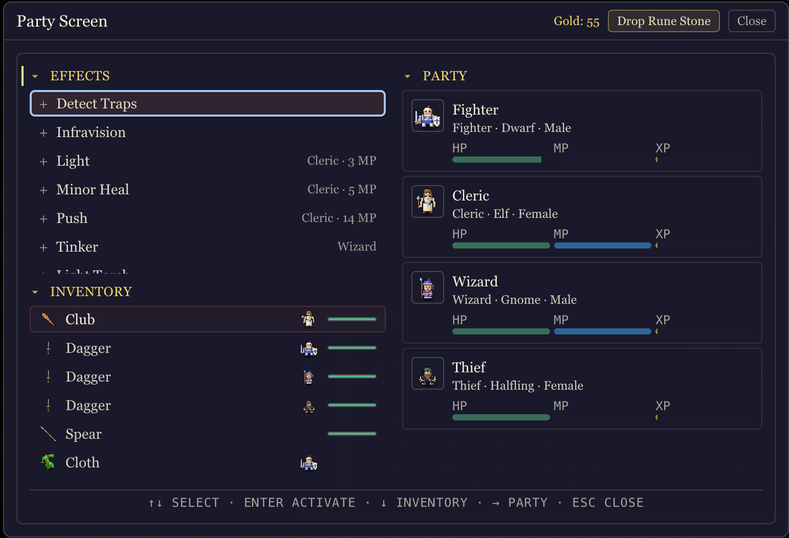

To use a character's abilities, such as crafting potions or arrows, select the character to open their character sheet. This shows the character's status and lets you equip items, use special abilities, and cast spells outside of combat. Casting a healing spell such as **Minor Healing** opens a target picker listing the party with each member's HP: move the highlight with the arrow keys and press `Enter` (or click) to heal that member, or `Esc` to cancel. **Resurrection** works the same way, but only fallen members can be picked. The whole Party screen can be driven from the keyboard.

  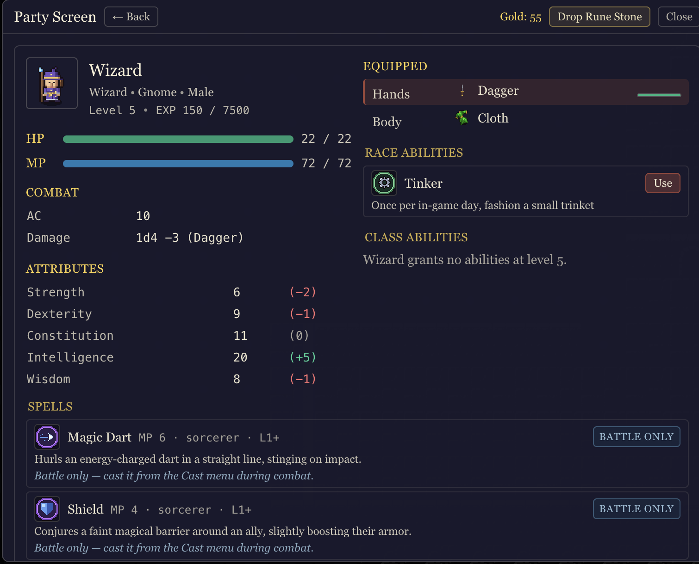

### Completing Quests

Quests are offered by the world's people and markers. Walk into a quest giver and you'll see what they're asking, with the choice to **Accept** or **Decline** (arrow keys and `Enter` work here too). Accepting adds the quest to your log, and the quest's targets begin to glow gold in the world.

Press `Q` at any time to open the **Quest Log**. Your adventure's **main quest** is pinned to the top with a ★; below it, quests are grouped into **Active**, **Ready to Turn In**, and **Completed**. Each entry shows the quest's current objective, and opening it reveals the description and every step with its details. Use `↑` `↓` to move between quests, `Enter` (or `→` / `←`) to open and close one, and the mouse wheel or `Page Up` / `Page Down` to scroll. `Q` or `Esc` closes the log.

Objectives come in several kinds:

- **Defeat** a particular foe, sometimes several times over.
- **Recover** an item from a specific place.
- **Find** a hidden spot — the step completes the moment you set foot on it.
- **Meet** a particular person, wherever they happen to be.
- **Descend** through a dungeon, floor by floor.
- **Clear** dungeons — defeat every foe in any dungeon (or in a set number of them).

Steps can usually be finished in any order, and progress updates automatically. Each completed step is marked with a brief celebration and may hand out something on the spot — an item you'll need next, or a change to the world such as a new bridge. When the last objective is done, most quests **complete right where you stand** and pay their reward (experience, gold, or items) immediately. Some ask you to **return to the quest giver** first; those wait under *Ready to Turn In* until you do.

Completing the **main quest** brings a special celebration and a recap of your whole adventure: quests completed, encounters won, dungeons cleared, experience earned, places discovered, and your party's levels. Choose **Continue adventuring** and the world is still yours to explore.

### Lore and the Journal

The world remembers its own history, and some of it is written down. Bookshelves, plaques, gravestones and inscriptions can be **read**: walk into one and its text opens on the page (you stay where you are). Some items are readable too: a book, a scroll or a letter in the Party screen (`P`) has a **Use** option that reads it, and reading never uses the item up.

The **first** time you read a piece of lore, every living member of the party earns experience (usually 25), and the lore is added to your **Journal**. Press `J` to open it: everything you've read is listed newest first, with **tags** like *History* or *Legends* you can click to show related lore, and a search box. Pick an entry to read it again; `↑` `↓` move between entries, and `J` or `Esc` closes the journal.

### Exploring Dungeons

Dungeons are the deep, dangerous heart of the game. Step onto a dungeon entrance on the world map to descend (the entrance's placard tells you whether you've been inside before); you'll move through it tile by tile just like the overworld, but dungeons run **multiple floors deep**, connected by stairs, and are far darker, so a Torch, the Light spell, or a Dwarf's Infravision becomes essential to see what's around you.

Many dungeons are **generated**: their layout is laid out fresh for each new game, so no two playthroughs explore quite the same halls. Each entrance leads to its own dungeon, and a dungeon remembers everything you did inside it: the floors you've mapped, the foes you've beaten, the traps you've sprung, and the chests you've emptied.

Down here you'll find waiting **monsters**, and in some places monster **lairs**. Engaging one drops you into the combat arena; importantly, a foe you defeat and a lair you clear are **gone for good** — neither respawns — so every fight you win makes the dungeon a little safer to backtrack through. Watch for traps and pick or unlock the doors barring your way.

**Treasure chests** hold gold and items. Step onto one and choose **Open** to take its contents, or **Leave** to come back for it later. An opened chest stays empty for good, even if you leave and return.

Defeat **every** foe on every floor and the dungeon is **cleared**: the whole party earns a one-time experience bonus, and from then on its entrance placard is marked **✓ Cleared**. When you've had your fill (or found what you came for), make your way back up the stairs to return to the surface.

### What Should You Do First?

On your very first playthrough, your party will start off weak with only a few sticks and stones as weapons. If you are lucky, you will have some camping supplies and a handful of gold coins to use for supplies. The world map is full of hostile creatures and dangerous locations, so your best bet is to find the nearest town. Once you're in that town, talk to the townspeople and you will find people with interesting things to say about the world you found yourself in. Some people will have quests that you can go on to gain gold and experience and some people will try to sell you their wares.

### Game Saves

Your progress is saved automatically as you play, so you can step away and pick up where you left off. Press `⌘S` (Mac) or `Ctrl-S` (Windows / Linux) to open the **save menu**, which has three manual save slots and an **Export Save File** button that downloads your game. Save games depend on your browser's local storage, which means they will be lost if you clear your browser's data, so export a copy of any game you care about.

---

## Races

Each race grants a set of innate abilities and applies stat modifiers when a character of that race is rolled.

Most races level up at the same rate. The exception is the **Fast Learner** ability (Humans): a character with it levels up about **25% faster** than everyone else. See [Experience & Leveling](#experience--leveling) under Character Classes for how leveling works.

<!-- BEGIN GENERATED: races — run `python3 docs/manual/build_races_abilities.py` to refresh -->

| Race | STR | DEX | CON | INT | WIS | Abilities |
|---|---:|---:|---:|---:|---:|---|
| **Dwarf** | 0 | -2 | +2 | -1 | 0 | Infravision |
| **Elf** | -2 | 0 | -1 | 0 | +2 | Nimble |
| **Gnome** | -2 | -1 | 0 | +2 | 0 | Tinker |
| **Halfling** | -2 | +2 | 0 | -1 | 0 | Pickpocket |
| **Human** | 0 | 0 | 0 | 0 | 0 | Fast Learner |
<!-- END GENERATED: races -->

## Character Classes

Class determines combat role, movement range per turn, which weapons and armor the character can equip, and which spell catalog (if any) they cast from. `Range` is the per-turn movement budget on the battle grid.

A class's full weapon and armor list appears in its entry in the Class Gallery below.

<!-- BEGIN GENERATED: class-comparison — run `python3 docs/manual/build_class_gallery.py` to refresh -->

| Class | Range | Casting | Abilities (min level) |
|---|---:|---|---|
| **Alchemist** | 2 | sorcerer | Brew Potion (L1) Herbalism (L1) |
| **Cleric** | 4 | priest | Turn Undead (L2) |
| **Druid** | 2 | sorcerer, priest | Dual Casting (L1) Herbalism (L1) |
| **Fighter** | 4 | none | — |
| **Paladin** | 4 | priest | Smite Undead (L1) Turn Undead (L3) |
| **Ranger** | 4 | priest | Craft Arrows (L2) Craft Fire Arrows (L3) |
| **Thief** | 6 | none | Detect Traps (L1) Pick Locks (L1) Backstab (L3) Shadow Step (L7) |
| **Wizard** | 2 | sorcerer | — |
<!-- END GENERATED: class-comparison -->

### Experience & Leveling

Characters earn **experience (XP)** by defeating monsters and by completing quests, plus a small bonus for exploring: the first time your party enters a new map, and the first time it talks to each person, everyone earns a little XP. Clearing every foe out of a dungeon earns a much larger one-time bonus. Every party member who is still standing shares in the reward — each one receives the *full* amount, not a split — and a member who has fallen earns nothing until revived. XP from quests now counts toward leveling immediately, the same as XP from battle.

**Each level costs more than the last.** The cost of advancing from one level to the next is a base of **1,500 experience** multiplied by your *current* level:

- Level 1 → 2 costs 1,500
- Level 2 → 3 costs 3,000
- Level 3 → 4 costs 4,500, and so on.

So the total XP to reach level *N* is `1,500 × N × (N − 1) ÷ 2`. A character with the **Fast Learner** ability (Humans) levels up about **25% faster** — their base is 1,125 instead of 1,500, making every one of those steps cheaper across a whole campaign.

**Leveling up makes a character stronger.** Every new level adds:

- **Hit points** = the class's HP-per-level **plus the character's Constitution modifier** (a high-CON hero gains a little more; the total is never less than +1).
- **Magic points** (spellcasters only) = the class's MP-per-level **plus the character's casting-stat modifier**. Priest casters use Wisdom, sorcerer casters use Intelligence, and the Druid uses the average of the two. Non-casters gain no MP.

These ability modifiers are not a one-time bonus — they apply on **every** level-up, so a high casting stat compounds. A Cleric with Wisdom 16 (a +3 modifier) gains 6 + 3 = **9** MP each level, while one with Wisdom 10 (+0) gains only the base **6**; the same Constitution math rewards a tough fighter with extra HP at every level. This is the payoff for rolling a high primary attribute.

A wounded character is partially healed by the HP and MP a level-up grants.

The per-level amounts are set by class — durable martial classes gain the most HP, while dedicated casters gain the most MP. The numbers below are added *before* the ability-score modifier described above:

<!-- BEGIN GENERATED: leveling-table — run `python3 docs/manual/build_class_gallery.py` to refresh -->

| Class | HP / level (base) | MP / level (base) | Casting stat |
|---|---:|---:|---|
| **Alchemist** | 4 | 4 | Intelligence |
| **Cleric** | 6 | 6 | Wisdom |
| **Druid** | 4 | 4 | Int & Wis (avg) |
| **Fighter** | 10 | — | — |
| **Paladin** | 6 | 2 | Wisdom |
| **Ranger** | 6 | 2 | Wisdom |
| **Thief** | 6 | — | — |
| **Wizard** | 4 | 8 | Intelligence |
<!-- END GENERATED: leveling-table -->

So MP growth is **not** the same for every caster: a **Wizard** gains the most (8 per level), a **Cleric** gains 6, a **Druid** or **Alchemist** gains 4, and a **Paladin** or **Ranger** gains 2. Fighters and Thieves are non-casters and gain no MP at all.

<!-- BEGIN GENERATED: class-gallery — run `python3 docs/manual/build_class_gallery.py` to refresh -->

### Class Gallery

A closer look at each class — how it plays, and what it brings to the party. _(This section is generated from `character_classes.json`; edit the data, not the prose here.)_

#### Alchemist

<table><tr>
<td width="170">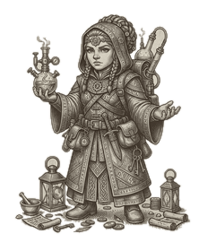</td>
<td>

A support specialist who turns the wild into an arsenal. Alchemists forage reagents (Herbalism) and Brew Potions from level 1, keeping the party stocked with healing and buffs. They cast from the sorcerer catalog but fight poorly — only a dagger, sling, and cloth — so they shine in the back ranks as a crafter and caster.

</td>
</tr></table>

| Move | Casting | Weapons & Armor | Abilities |
|:--:|:--|:--|:--|
| 2 | Sorcerer | 4 weapon types · up to cloth armor | Brew Potion (L1), Herbalism (L1) |

#### Cleric

<table><tr>
<td>

The party's divine anchor. Clerics draw on the priest catalog to heal and protect, wade in wearing chain with a mace or sling, and from level 2 can Turn Undead to wither the unliving. Slow on their feet at two tiles a turn, they reward patient, central positioning over aggression.

</td>
<td width="170">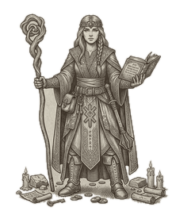</td>
</tr></table>

| Move | Casting | Weapons & Armor | Abilities |
|:--:|:--|:--|:--|
| 4 | Priest | 5 weapon types · up to chain armor | Turn Undead (L2) |

#### Druid

<table><tr>
<td width="170">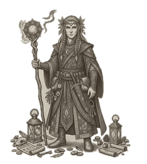</td>
<td>

The only class that wields both arcane and divine magic, thanks to Dual Casting from level 1. Druids forage for reagents as they travel (Herbalism) and fight in leather with simple weapons. Versatile but slow at two tiles a turn and squishier than a true warrior — a flexible spellcaster for players who like options.

</td>
</tr></table>

| Move | Casting | Weapons & Armor | Abilities |
|:--:|:--|:--|:--|
| 2 | Sorcerer + Priest | 6 weapon types · up to leather armor | Dual Casting (L1), Herbalism (L1) |

#### Fighter

<table><tr>
<td>

The workhorse of any party. Fighters command the widest armory in the game — every weapon family from fists to halberds and every armor from cloth to plate — and cover a brisk four tiles a turn. They cast no spells and have no special tricks; their strength is sheer durability and reliability, which makes them ideal in the lead slot soaking the first blows.

</td>
<td width="170">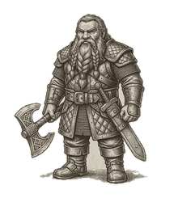</td>
</tr></table>

| Move | Casting | Weapons & Armor | Abilities |
|:--:|:--|:--|:--|
| 4 | No spells | All weapons & armor | — |

#### Paladin

<table><tr>
<td width="170">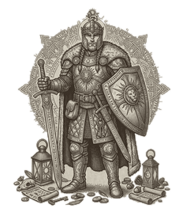</td>
<td>

A holy warrior who fights on the front line and channels divine power. Paladins move four tiles a turn, wear chain and wield swords and spears, Smite Undead for double damage from level 1, and gain Turn Undead at level 5. They trade the Cleric's spell depth for martial muscle — the party's anti-undead vanguard.

</td>
</tr></table>

| Move | Casting | Weapons & Armor | Abilities |
|:--:|:--|:--|:--|
| 4 | Priest | 10 weapon types · up to chain armor | Smite Undead (L1), Turn Undead (L3) |

#### Ranger

<table><tr>
<td>

A wilderness hunter built around ranged combat. Rangers favor bows — the crossbow included — and craft their own Arrows (level 2) and Fire Arrows (level 5) so they never run dry. They draw on a small priest catalog and move a nimble four tiles a turn: a self-sufficient skirmisher.

</td>
<td width="170">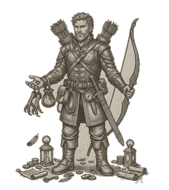</td>
</tr></table>

| Move | Casting | Weapons & Armor | Abilities |
|:--:|:--|:--|:--|
| 4 | Priest | 8 weapon types · up to leather armor | Craft Arrows (L2), Craft Fire Arrows (L3) |

#### Thief

<table><tr>
<td width="170">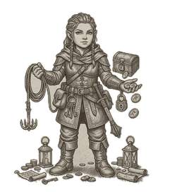</td>
<td>

The fastest, sneakiest member of any party, covering six tiles a turn. Thieves pick locks and spot traps from level 1, land devastating Backstab criticals with daggers from level 3, and at level 7 can Shadow Step to move again after striking. Lightly armored and non-magical, they win through speed, utility, and hit-and-run positioning.

</td>
</tr></table>

| Move | Casting | Weapons & Armor | Abilities |
|:--:|:--|:--|:--|
| 6 | No spells | 5 weapon types · up to leather armor | Detect Traps (L1), Pick Locks (L1), Backstab (L3), Shadow Step (L7) |

#### Wizard

<table><tr>
<td>

A glass cannon of raw arcane power. Wizards cast from the sorcerer catalog but are the frailest class — limited to cloth and a dagger or club, and only two tiles of movement. Keep them well behind the front line: their spells can decide a fight, but a single solid hit can end them.

</td>
<td width="170">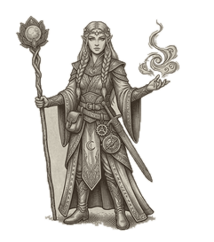</td>
</tr></table>

| Move | Casting | Weapons & Armor | Abilities |
|:--:|:--|:--|:--|
| 2 | Sorcerer | 4 weapon types · up to cloth armor | — |

<!-- END GENERATED: class-gallery -->

## Abilities

Abilities are named capabilities granted by Race or Class (or other sources). The `Where` column tells you where the ability can be triggered: `battle` (combat action menu), `party` (Use button on the character sheet), or `passive` (always-on / auto-triggered).

### Class Abilities

<!-- BEGIN GENERATED: class-abilities — run `python3 docs/manual/build_races_abilities.py` to refresh -->

| Icon | Ability | Description | Where | Duration |
|---|---|---|---|---|
| 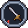 | **Backstab** | Critical hits with daggers on a successful DEX save — the humble dagger becomes a devastating weapon. | passive | permanent |
|  | **Brew Potion** | Combine regents using the guidance of a recipe to create a potion | party |  |
|  | **Craft Arrows** | Allows the character to craft a bundle of arrows or bolts once per day. | party |  |
|  | **Craft Fire Arrows** | Allows the character to craft a bundle of fire arrows or fire bolts once per day. | party |  |
|  | **Detect Traps** | Hidden traps are revealed before the party steps on them. | passive | permanent |
|  | **Dual Casting** | Access to both the priest and sorcerer spell catalogs — the only class with both. | passive | permanent |
|  | **Herbalism** | Nature lore spots reagents in the wild while travelling. Each step on a foraging tile (grass, forest, …) has a small chance to turn up a potion reagent. Alchemists in particular benefit from a doubled find rate. | passive | permanent |
|  | **Pick Locks** | Pick locked doors and chests — d20 + DEX mod vs DC 12, one lockpick consumed per attempt. | passive | permanent |
|  | **Shadow Step** | Move after attacking — true hit-and-run play. | passive | permanent |
|  | **Smite Undead** | Attacks against undead creatures deal double damage | passive |  |
|  | **Turn Undead** | Channel holy energy at every undead on the battlefield. Each one must make a Wisdom save (d20 + WIS mod vs DC 10 + caster's WIS mod) or be destroyed outright; those that succeed are still seared for 50% of their HP in radiant damage. Powerful undead (vampires, liches, …) add their turn resistance to the save and are never destroyed outright — on a failed save they are seared and TURNED, fleeing the holy light for 1d4 turns. | battle | instant |
<!-- END GENERATED: class-abilities -->

### Race Abilities

<!-- BEGIN GENERATED: race-abilities — run `python3 docs/manual/build_races_abilities.py` to refresh -->

| Icon | Ability | Description | Where | Duration |
|---|---|---|---|---|
|  | **Fast Learner** | Requires only 1125 XP per level instead of the standard 1500, leveling up roughly 25% faster than other races. | passive | permanent |
|  | **Infravision** | Pierces darkness, revealing the world in shades of red. The bearer can see in absolute darkness without needing a torch. | passive | permanent |
|  | **Nimble** | Allows extra movement | passive | permanent |
|  | **Pickpocket** | Attempt to steal items from town NPCs. Once per NPC, with a chance of failure. | passive | permanent |
|  | **Tinker** | Once per in-game day, fashion a small trinket | party | permanent |
<!-- END GENERATED: race-abilities -->

<!-- BEGIN GENERATED: spells — run `python3 docs/manual/build_spells.py` to refresh -->

## Spells

Spells are MP-cost actions castable by classes that have a matching `casting_type`. The `Damage / Roll` column shows the dice a spell rolls — damage or healing as `{dice} + STAT` (e.g. `2d8 + INT`), with percentage values for spells that restore or revive; a dash means the spell has no roll (buffs, status effects, and utility). _(This section is generated from `spells.json`; edit the data, not the prose here.)_

### Priest Spells

| Icon | Spell | MP | Min Lvl | Range | Damage / Roll | Description |
|---|---|---:|---:|---:|---|---|
|  | **Light** | 3 | 1 | 0 | — | Conjures a radiant orb of divine light at a chosen spot — anywhere on the battlefield. |
|  | **Minor Heal** | 5 | 1 | 6 | 1d6 + WIS healed | Sends a gentle wave of healing energy toward an ally or the caster. |
|  | **Cure Poison** | 5 | 2 | 99 | — | Draws the venom from an ally's body with a cleansing prayer, removing the poisoned condition. |
|  | **Bless** | 10 | 3 | 0 | — | Invokes a divine blessing that empowers all allies, granting them greater accuracy in battle. |
|  | **Curse** | 10 | 3 | 99 | — | Calls down a dark malediction on an enemy, weakening its defenses and dulling its attacks. |
|  | **Major Heal** | 15 | 4 | 10 | 4d8 + WIS healed | Channels a powerful wave of restorative energy toward an ally, mending grievous wounds. |
|  | **Push** | 14 | 5 | 0 | — | Emits a powerful wave of divine force that drives nearby monsters away from the party. |
|  | **Mass Heal** | 25 | 6 | 0 | 3d10 + WIS healed | A burst of divine light radiates from the caster, restoring health to all nearby allies. |
|  | **Restore** | 35 | 7 | 0 | 100% HP / 100% MP restored | A radiant pillar of divine power engulfs the party, fully restoring health to all allies and mana to everyone but the caster, purging all poisons from their bodies. |
|  | **Daylight** | 20 | 8 | 0 | — | Floods the entire battlefield with brilliant daylight for the rest of the battle, banishing every shadow. |
|  | **Divine Smite** | 60 | 9 | 6 | 10d10 + WIS radiant (×1.5 vs undead) | Calls down a searing column of holy radiance that scours a single enemy — and burns the undead half again as hard. |
|  | **Resurrection** | 50 | 10 | 6 | 50% HP revived | Channels life back into a fallen companion, raising them from the dead at half their full strength. |

### Sorcerer Spells

| Icon | Spell | MP | Min Lvl | Range | Damage / Roll | Description |
|---|---|---:|---:|---:|---|---|
|  | **Shield** | 4 | 1 | 5 | — | Conjures a faint magical barrier around an ally, slightly boosting their armor. |
|  | **Sleep** | 5 | 1 | 99 | — | Lulls a weak-minded creature into a light magical slumber. |
|  | **Magic Dart** | 6 | 1 | 4 | 1d6 + INT | Hurls an energy-charged dart in a straight line, stinging on impact. |
|  | **Knock** | 6 | 2 | 1 | — | Sends a pulse of arcane force into a lock's mechanism, rattling tumblers and wards alike. Cast from the locked-door dialog when the party bumps a lock. |
|  | **Long Shanks** | 6 | 2 | 99 | — | Enchants an ally's legs with unnatural speed, extending their movement range for 3 turns. May also be cast on yourself. |
|  | **Magic Arrow** | 12 | 3 | 99 | 2d8 + INT | Conjures a piercing bolt of arcane energy that streaks toward a chosen foe. |
|  | **Misty Step** | 8 | 4 | 6 | — | The caster vanishes in a swirl of silvery mist and reappears at a chosen location on the battlefield. |
|  | **Invisibility** | 16 | 4 | 0 | — | The caster bends light around themselves, becoming invisible to enemies for 3 turns. |
|  | **Charm Person** | 14 | 5 | 99 | — | Weaves an enchantment that bends the will of a humanoid creature, turning it against its allies for 3 turns. |
|  | **Lightning Bolt** | 25 | 5 | 99 | 6d6 + INT lightning | Unleashes a searing bolt of lightning that streaks in a straight line, electrocuting everything in its path. |
|  | **Animate Dead** | 20 | 6 | 99 | — | Raises a powerful skeleton warrior from the earth to fight for the caster. |
|  | **Fireball** | 30 | 7 | 99 | 5d8 + INT fire | Hurls a massive ball of flame that detonates in a 3-tile radius, scorching everything — friend or foe — caught in the blast. |
|  | **Recall** | 25 | 8 | 0 | — | Folds space around the whole party, drawing them back to their last rune stone — or, if none was placed, to where their journey began. |
|  | **Meteor Shower** | 70 | 9 | 99 | 8d8 + INT fire | Calls a rain of blazing meteors down on every foe on the battlefield, scorching them all at once. |
|  | **Void Orb** | 80 | 10 | 99 | 10d12 + INT void | Conjures a sphere of absolute void that collapses on a single enemy, unmaking them with devastating force. |

<!-- END GENERATED: spells -->

<!-- BEGIN GENERATED: items — run `python3 docs/manual/build_items.py` to refresh -->

## Items

Items are grouped by category, one table each. **Weapons** list **Base Damage** — the dice the weapon rolls before the wielder's Strength/Dexterity modifier and any magical Damage Bonus — with all melee weapons first, then all ranged, each ordered weakest to strongest. **Armor** lists **Base AC**, the Armor Class a typical adventurer has while wearing it, ordered least to most protective. The remaining tables cover consumables, ammunition, reagents, quest items, and the like; their **Type** column names the exact kind.

### Weapons

| Icon | Item | Type | Base Damage | Durability | Damage Bonus | Damage Type | Special | Buy |
|:---:|---|---|---:|---:|---|---|---|---:|
|  | **Club** | Club | 1d4-1 | 12 |  |  |  | 20 |
|  | **Dagger** | Dagger | 1d4-1 | 20 |  |  | throwable | 20 |
|  | **Mace** | Mace | 1d4 | 20 |  |  |  | 40 |
|  | **Sword** | Sword | 1d6 | 20 |  |  |  | 40 |
|  | **Spear** | Spear | 1d8 | 20 |  |  |  | 50 |
| 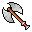 | **Broad Axe** | Axe | 1d8 | 20 |  |  |  | 0 |
|  | **Iron Sword** | Sword | 1d8 | 50 |  |  |  | 0 |
| 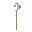 | **Halberd** | Halberd | 1d10 | 20 |  |  |  | 0 |
|  | **Sun Sword** | Sword | 2d8 | 0 | 1d6 | fire |  | 0 |
|  | **Rock** | Rock | 1d6+1 | 0 |  |  | ranged, throwable | 0 |
|  | **Sling** | Sling | 1d6+2 | 20 |  |  | ranged, uses stones | 60 |
|  | **Short Bow** | Short Bow | 1d6+4 | 30 |  |  | ranged, uses arrows | 60 |
|  | **Long Bow** | Long Bow | 1d6+7 | 20 |  |  | ranged, uses arrows | 150 |
| 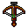 | **Crossbow** | Crossbow | 1d6+9 | 20 |  |  | ranged, uses bolts | 250 |
|  | **Silver Bow** | Long Bow | 1d6+9 | 0 |  |  | ranged, uses arrows |  |

### Armor

| Icon | Item | Type | Base AC | Durability | Buy | Sell |
|:---:|---|---|---:|---:|---:|---:|
|  | **Cloth** | Cloth | 11 | 0 | 20 | 10 |
|  | **Leather** | Leather | 13 | 20 | 50 | 25 |
|  | **Chain** | Chain | 14 | 50 | 120 | 60 |
|  | **Plate** | Plate | 15 | 20 | 200 | 150 |
|  | **Stoneguard Plate** | Plate | 18 | 0 | 0 | 0 |

### Ammo

| Icon | Item | Type | Power | Effect | Charges | Stackable | Buy | Description |
|:---:|---|---|---:|---|---:|:---:|---:|---|
|  | **Arrows** | Ammo |  |  | 20 | ✓ | 5 | A bundle of arrows for bows. |
|  | **Bolts** | Ammo |  |  | 20 | ✓ | 8 | Heavy crossbow bolts with iron tips. |
|  | **Fire Arrows** | Ammo | 3 |  | 20 | ✓ | 25 | A bundle of fire arrows. Fire arrows explode on impact and produce the same effect as a thrown torch — they light the tile they land on and damage anyone standing in it. |
|  | **Fire Bolts** | Ammo | 3 |  | 20 | ✓ | 30 | A bundle of fire bolts for crossbows. Tipped with the same alchemical compound as fire arrows — they explode on impact, lighting the tile they land on and damaging anyone standing in it. |
|  | **Stones** | Ammo |  |  | 20 | ✓ | 3 | A pouch of smooth stones for slings. |

### Potions

| Icon | Item | Type | Power | Effect | Charges | Stackable | Buy | Description |
|:---:|---|---|---:|---|---:|:---:|---:|---|
|  | **Antidote** | Antidote |  | cure_poison | 1 | ✓ | 10 | A bitter tincture that cures poison. |
|  | **Lingering Venom** | Poison Potion | 2 | combat_only |  |  | 70 | A potent toxin that persists far longer than ordinary poisons. |
|  | **Paralytic Poison** | Poison Potion | 2 | combat_only |  |  | 75 | A nerve toxin that drains magical energy. Apply to a weapon or throw at enemies. |
| 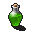 | **Poison Vial** | Poison Potion | 2 | combat_only |  |  | 50 | A vial of toxic liquid. Apply to a weapon or throw at enemies to inflict poison damage. |
| 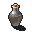 | **Weakening Poison** | Poison Potion | 2 | combat_only |  |  | 60 | A venom that saps fighting prowess. Apply to a weapon or throw at enemies. |
|  | **Elixir of Strength** | Potion | 2 | buff_strength | 1 | ✓ | 60 | A thick crimson brew. Grants +2 STR for the next combat. |
|  | **Elixir of Warding** | Potion | 2 | buff_ac | 1 | ✓ | 60 | A silver-tinged potion. Grants +2 AC for the next combat. |
| 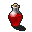 | **Healing Potion** | Potion | 30 | heal_hp | 1 | ✓ | 40 | A ruby-red elixir that mends wounds. Restores a large amount of HP. |
|  | **Mana Potion** | Potion | 10 | heal_mp | 1 | ✓ | 40 | A shimmering blue liquid that restores magic points. |
| 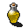 | **Fire Oil** | Throwable | 20 |  |  |  | 35 | A volatile oil that bursts into a small 3x3 gout of flame where it lands. Throw at an enemy or tile. |

### Scrolls

| Icon | Item | Type | Power | Effect | Charges | Stackable | Buy | Description |
|:---:|---|---|---:|---|---:|:---:|---:|---|
|  | **Scroll of Fire** | Scroll |  |  |  |  |  | A single-use scroll containing a fire spell. |

### Reagents

| Icon | Item | Type | Power | Effect | Charges | Stackable | Buy | Description |
|:---:|---|---|---:|---|---:|:---:|---:|---|
|  | **Brimite Ore** | Reagent |  |  | 1 | ✓ | 15 | A volatile mineral that smolders with inner heat. |
|  | **Glowcap Mushroom** | Reagent |  |  | 1 | ✓ | 10 | A blue-capped fungus that pulses with arcane energy. |
|  | **Moonpetal** | Reagent |  |  | 1 | ✓ | 12 | A luminous flower petal that glows faintly in the dark. Prized by alchemists. |
|  | **Serpent Root** | Reagent |  |  | 1 | ✓ | 8 | A twisted root with potent cleansing properties. |
|  | **Spring Water** | Reagent |  |  | 1 | ✓ | 3 | Pure water from a mountain spring. Essential for brewing. |

### General Items

| Icon | Item | Type | Power | Effect | Charges | Stackable | Buy | Description |
|:---:|---|---|---:|---|---:|:---:|---:|---|
|  | **Camping Supplies** | Camping Supplies | 0 | rest | 3 | ✓ | 25 | A bedroll, flint, and dried rations. Lets the party rest safely in the wilderness. |
|  | **Healing Herb** | Herb | 15 | heal_hp | 1 | ✓ | 15 | A fragrant herb that restores a small amount of HP. |
|  | **Iron Key** | Key |  |  | 1 | ✓ | 10 | A heavy iron key that can unlock one locked door. |
| 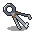 | **Lockpick** | Lockpick |  |  | 5 | ✓ | 8 | A set of fine lockpicking tools. Consumed on each attempt. |
| 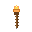 | **Torch** | Torch | 3 |  | 1 | ✓ | 5 | A wooden torch. Lights the way in dark places. |

### Container

| Icon | Item | Type | Power | Effect | Charges | Stackable | Buy | Description |
|:---:|---|---|---:|---|---:|:---:|---:|---|
|  | **Treasure Chest** | Container |  |  |  |  | 0 | A sturdy wooden chest bound in iron. Whatever is inside, someone wanted it kept safe. |

### Quest Items

| Icon | Item | Type | Power | Effect | Charges | Stackable | Buy | Description |
|:---:|---|---|---:|---|---:|:---:|---:|---|
|  | **Chest** | Chest | 0 |  |  |  | 0 | A lost chest |
|  | **Silver Key** | Quest Item |  |  |  |  |  | A gleaming silver key inscribed with arcane formulae. One of the 8 Keys of Shadow. |
|  | **The Crystal Skull** | Quest Item |  |  |  |  |  | A flawless skull carved from a single piece of clear crystal. Pale light gathers in its eye sockets, as if something is looking back. |

<!-- END GENERATED: items -->

<!-- BEGIN GENERATED: monsters — run `python3 docs/manual/build_monsters.py` to refresh -->

## Monsters

Every monster in the game, sorted by difficulty (easy → normal → hard → deadly → boss), then by HP. **Damage** is the attack dice; **Move** is the tile budget per turn. The **Tags** column notes type (undead / humanoid — undead matters for Smite Undead and Turn Undead) and hit-and-run behaviour.

| Sprite | Monster | Diff | HP | AC | Atk | Damage | Move | XP | Gold | Tags |
|:---:|---|---|---:|---:|---:|---|---:|---:|---:|---|
| 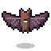 | **Giant Bat** | easy | 6 | 13 | +3 | 1d4 | 10 | 15 | 0–0 | hit-and-run 3 |
| 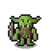 | **Goblin** | easy | 7 | 13 | +3 | 1d6 | 6 | 20 | 2–10 | humanoid, hit-and-run 2 |
| 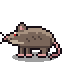 | **Giant Rat** | easy | 8 | 12 | +2 | 1d4 | 10 | 15 | 2–8 |  |
|  | **Slime Mold** | easy | 14 | 7 | +2 | 1d4 | 1 | 20 | 0–0 |  |
| 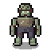 | **Zombie** | easy | 22 | 8 | +3 | 1d6+1 | 2 | 30 | 0–0 | undead |
| 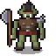 | **Orc** | normal | 15 | 13 | +4 | 1d10+1 | 5 | 40 | 5–20 | humanoid |
|  | **Skeleton** | normal | 16 | 13 | +3 | 1d6+1 | 3 | 30 | 5–15 | undead |
|  | **Ghost** | normal | 18 | 12 | +3 | 1d6 | 6 | 55 | 0–0 | undead, hit-and-run 1 |
|  | **Giant Spider** | normal | 26 | 14 | +5 | 1d8+2 | 6 | 60 | 0–0 |  |
|  | **Gelatinous Cube** | normal | 40 | 6 | +4 | 1d6+1 | 2 | 70 | 5–30 |  |
| 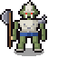 | **Orc War-Priest** | hard | 24 | 14 | +4 | 1d8+2 | 5 | 90 | 10–30 | humanoid |
| 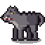 | **Dire Wolf** | hard | 26 | 14 | +4 | 1d8+2 | 8 | 60 | 0–0 |  |
|  | **Air Elemental** | hard | 40 | 15 | +6 | 1d8+3 | 10 | 200 | 0–0 | hit-and-run 3 |
|  | **Fire Elemental** | hard | 45 | 13 | +6 | 1d10+3 | 7 | 200 | 0–0 |  |
|  | **Demon** | hard | 50 | 15 | +6 | 1d10+3 | 7 | 250 | 20–80 |  |
|  | **Water Elemental** | hard | 50 | 14 | +6 | 1d8+4 | 5 | 200 | 0–0 |  |
|  | **Troll** | hard | 60 | 15 | +6 | 1d10+4 | 5 | 200 | 10–40 |  |
|  | **Earth Elemental** | hard | 65 | 17 | +6 | 1d12+3 | 3 | 200 | 0–0 |  |
|  | **Vampire** | deadly | 65 | 16 | +6 | 1d8+4 | 6 | 600 | 50–200 | undead, humanoid |
|  | **Lich** | deadly | 75 | 16 | +6 | 1d8+3 | 3 | 800 | 100–300 | undead, humanoid |
| 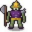 | **The Orc King** | boss | 90 | 16 | +7 | 1d12+4 | 5 | 1000 | 150–300 | humanoid |
|  | **Red Dragon** | boss | 160 | 18 | +8 | 2d8+4 | 6 | 2000 | 500–1500 |  |

<!-- END GENERATED: monsters -->

## Frequently Asked Questions

### What Should I Do First?

On your very first playthrough, your party will start off weak with only a few sticks and stones as weapons. If you are lucky, you will have some camping supplies and a handful of gold coins to use for supplies. The world map is full of hostile creatures and dangerous locations, so your best bet is to find the nearest town.

Once you're in town, talk to the townspeople and you will find people with interesting things to say about the world you found yourself in. Some people will have quests that you can go on to gain gold and experience and some people will try to sell you their wares.

Get used to the controls, press the "P" key to see the state of your party, manage your inventory and view individual characters. Make sure each is ready for the next adventure. Once you have explored town and completed a few quests, it is time to venture out into the far more dangerous world.

Sometimes, you may see the King's Eagle flying nearby. This is King Wellerman's messenger and the eagle will have important information that you will need to start your adventure.

### How do I restore HP and MP between fights?

Rest with Camping Supplies from the Party screen, or visit a temple in town.
A Cleric or other healer can also cast healing spells on the party screen
outside of combat. Sometimes, simply spending time in an inn or a grove will slowly replenish your hit points and magic points.

### Where do potion reagents come from?

A Druid or Alchemist in the party gathers reagents automatically while you
travel across foraging terrain (grass, forest, and similar tiles). An
Alchemist can then brew them into potions from the Party screen. The party can also purchase reagents from certain townspeople and counters.

<!--
  OPTIONAL: data-driven FAQ entries.

  If you ever want part of this FAQ generated from game data (the way the
  Class Gallery is), wrap just that portion in a marker pair and add a small
  builder script that rewrites only the text between the markers — exactly
  the pattern in docs/manual/build_class_gallery.py. The markers look like:

    [BEGIN GENERATED: faq]   ...generated entries...   [END GENERATED: faq]

  (use real HTML-comment markers, not these square brackets). Everything
  outside the markers — including all of the hand-written Q&A above — stays
  untouched on every run.
-->
